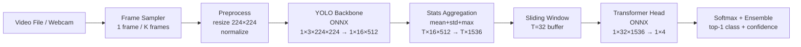

# Phase 05 — Thesis Artifacts

**Status:** done (2026-04-19)
**Priority:** P1
**Estimated time:** 6h (actual ~1h)

---

## Delivered

- `deployment/artifacts/figures/arch-diagram.mmd` — Mermaid pipeline diagram.
- `deployment/scripts/generate-figures.py` (152 lines) — produces 4 PNGs from JSON.
- `deployment/artifacts/figures/latency-by-stage.png` — stacked stage bars × 4 configs.
- `deployment/artifacts/figures/fps-vs-streams.png` — N=1..4 scaling + ideal reference.
- `deployment/artifacts/figures/accuracy-by-config.png` — ensemble vs baseline line.
- `deployment/artifacts/figures/model-size-comparison.png` — FP32 vs INT8 grouped bars.
- `deployment/README.md` — full reproduction guide (7 commands + Netron manual step).
- `plans/260417-1913-track-b-edge-deployment/chapter-05-skeleton.md` — 8-section bullet outline with all measured numbers.
- `deployment/artifacts/asset-checklist.md` — 11-row asset table with thesis targets.

### Remaining Manual Step
`netron deployment/export/direct4-s314-fp32.onnx` → screenshot → save as `figures/onnx-graph-direct4.png`. Command documented in README and checklist.
**Dependency:** Phase 02 (`benchmarks.json`) + Phase 03 (`multi-stream-results.json`)

---

## Context Links

- Input: `deployment/artifacts/benchmarks.json` (Phase 02)
- Input: `deployment/artifacts/multi-stream-results.json` (Phase 03)
- Output: `deployment/artifacts/figures/` — all charts + tables
- Output: `deployment/README.md` — reproduction guide
- Output: `plans/260417-1913-track-b-edge-deployment/chapter-05-skeleton.md` — thesis skeleton
- Output: `deployment/artifacts/projections.md` (produced in Phase 02, finalised here)

---

## Overview

Generate every figure and table required for thesis Chapter 5 (Edge Deployment). All figures
are produced from measured data (benchmarks.json, multi-stream-results.json) — no hand-crafted
numbers. Write `deployment/README.md` so the entire pipeline is reproducible from a clean
checkout. Write the Chapter 5 skeleton in Markdown as a bullet outline. Produce a checklist
of all assets with target locations for the thesis document.

---

## Key Insights

- Figures must be generated programmatically from JSON data files so they update automatically
  if benchmarks are re-run. Use matplotlib with tight_layout(); save as PNG at 150 dpi
  (sufficient for PDF thesis) to `deployment/artifacts/figures/`.
- Architecture diagram: Mermaid LR graph is simplest and renders in GitHub preview; also
  render to PNG via `mmdc` CLI if available (not mandatory). Provide Mermaid source in a
  `.mmd` file so supervisor can view it.
- Netron ONNX graph: Netron is a desktop app — take a screenshot manually of one representative
  model (direct4_s314_fp32.onnx) and save to `deployment/artifacts/figures/onnx-graph-direct4.png`.
  Include the instruction in README; do not automate (no headless Netron API).
- Chapter 5 skeleton is a bullet outline only — not prose. Each section gets 4-6 bullet points
  of content to write. This skeleton is the deliverable; prose writing is out of scope for Track B.
- `deployment/README.md` must be self-contained: someone with a fresh clone should be able to
  reproduce exports → benchmarks → dashboard in ≤ 10 commands.

---

## Requirements

### Functional
- Figure 1: Architecture diagram (Mermaid LR) — Video → FrameSample → Backbone → StatsAgg → Head → Softmax
- Figure 2: Latency bar chart — per EP (CPU-FP32, CPU-INT8, CoreML) × stage (stacked bars), matplotlib
- Figure 3: FPS vs stream-count line chart — N=1,2,3,4 from multi-stream-results.json
- Figure 4: Model size comparison table — FP32 vs INT8, per component (Markdown table in benchmarks.md)
- Figure 5: ONNX graph screenshot — manual Netron capture; README instruction provided
- Figure 6: Projection table — M4 measured → Jetson Orin Nano projected (finalised from Phase 02)
- Write `deployment/README.md` — reproduction steps
- Write `chapter-05-skeleton.md` — bullet outline, all sections
- Write `deployment/artifacts/asset-checklist.md` — figure/table name + target location

### Non-functional
- All figure-generation scripts < 200 lines
- Script idempotent: skip if PNG already newer than source JSON
- No external services (no Plotly Cloud, no Colab required for figures)

---

## Related Code Files

**Create:**
- `deployment/scripts/generate-figures.py` — produces Figures 2, 3; reads JSON inputs
- `deployment/artifacts/figures/arch-diagram.mmd` — Mermaid source for Figure 1
- `deployment/artifacts/figures/latency-by-stage.png` — Figure 2
- `deployment/artifacts/figures/fps-vs-streams.png` — Figure 3
- `deployment/artifacts/figures/onnx-graph-direct4.png` — Figure 5 (manual screenshot)
- `deployment/README.md`
- `plans/260417-1913-track-b-edge-deployment/chapter-05-skeleton.md`
- `deployment/artifacts/asset-checklist.md`

**Read (do not modify):**
- `deployment/artifacts/benchmarks.json` — Phase 02 output
- `deployment/artifacts/multi-stream-results.json` — Phase 03 output
- `deployment/artifacts/projections.md` — Phase 02 output

---

## Implementation Steps

### Step 1 — Write `arch-diagram.mmd` (20 min)



Save as `deployment/artifacts/figures/arch-diagram.mmd`.

### Step 2 — Write `generate-figures.py` (2.5h)

```python
# deployment/scripts/generate-figures.py
import json, matplotlib.pyplot as plt, numpy as np, os

BM = json.load(open('deployment/artifacts/benchmarks.json'))
MS = json.load(open('deployment/artifacts/multi-stream-results.json'))
FIG_DIR = 'deployment/artifacts/figures'
os.makedirs(FIG_DIR, exist_ok=True)

# --- Figure 2: Latency bar chart (stacked by stage, grouped by EP) ---
def plot_latency_by_stage(bm):
    stages = ['preprocess', 'backbone', 'stats_agg', 'head', 'softmax_ensemble']
    eps    = ['CPU-FP32', 'CPU-INT8', 'CoreML']
    # Extract p50 per stage per EP from bm['configs']
    ...
    fig, ax = plt.subplots(figsize=(8, 5))
    x = np.arange(len(eps))
    bottom = np.zeros(len(eps))
    for stage in stages:
        vals = [ep_data[stage]['p50'] for ep_data in ...]
        ax.bar(x, vals, bottom=bottom, label=stage)
        bottom += np.array(vals)
    ax.set_xticks(x); ax.set_xticklabels(eps)
    ax.set_ylabel('Latency (ms)'); ax.set_title('End-to-End Latency by Stage')
    ax.legend(loc='upper right')
    plt.tight_layout()
    plt.savefig(f'{FIG_DIR}/latency-by-stage.png', dpi=150)
    plt.close()

# --- Figure 3: FPS vs stream count ---
def plot_fps_vs_streams(ms):
    configs = sorted(ms['configs'], key=lambda c: c['n_streams'])
    n_vals = [c['n_streams'] for c in configs]
    fps_vals = [c['aggregate_fps'] for c in configs]
    ideal = [n * fps_vals[0] for n in n_vals]
    fig, ax = plt.subplots(figsize=(6, 4))
    ax.plot(n_vals, fps_vals, 'bo-', label='Measured')
    ax.plot(n_vals, ideal, 'k--', label='Ideal linear')
    ax.set_xlabel('Number of Streams'); ax.set_ylabel('Aggregate FPS')
    ax.set_title('Multi-stream Throughput Scaling')
    ax.legend(); plt.tight_layout()
    plt.savefig(f'{FIG_DIR}/fps-vs-streams.png', dpi=150)
    plt.close()

if __name__ == '__main__':
    plot_latency_by_stage(BM)
    plot_fps_vs_streams(MS)
    print('Figures written to', FIG_DIR)
```

### Step 3 — Write `deployment/README.md` (1h)

Sections:
1. Prerequisites (`pip install -r requirements.txt`, ultralytics, onnxruntime, streamlit)
2. Export: `python deployment/scripts/export-backbone.py && python deployment/scripts/export-transformer-heads.py`
3. Verify parity: `python deployment/scripts/verify-onnx-parity.py`
4. Benchmark: `python deployment/scripts/benchmark-harness.py --ep cpu --precision both`
5. Multi-stream: `python deployment/scripts/multi-stream-pipeline.py --streams 2 --source vid1.mp4 vid2.mp4`
6. Dashboard: `streamlit run deployment/dashboard/app.py`
7. Generate figures: `python deployment/scripts/generate-figures.py`
8. Netron graph: `netron deployment/export/direct4_s314_fp32.onnx` → screenshot → save as `figures/onnx-graph-direct4.png`

Keep under 80 lines.

### Step 4 — Write `chapter-05-skeleton.md` (45 min)

Write `plans/260417-1913-track-b-edge-deployment/chapter-05-skeleton.md` with 8 sections,
each as 4-6 bullet placeholders (fill measured numbers from JSON after Phase 02+03):

- **5.1 Introduction** — motivation, Objective 3, best ensemble, scope (M4 + Orin projection)
- **5.2 System Architecture** — pipeline diagram ref, component roles, ONNX rationale
- **5.3 Export Pipeline** — BackboneWrapper approach, T=32 fixed, INT8 quant, parity results
- **5.4 Benchmarks** — hardware, p50/p95/p99 table ref, model sizes, INT8 speedup, CoreML result
- **5.5 Multi-Stream** — batched backbone, fps-vs-streams chart ref, drops, utilisation
- **5.6 Jetson Projection** — method, ratio source [CITATION], projection table ref
- **5.7 Limitations** — resolution mismatch, small test set, unverified projection, no live camera
- **5.8 Conclusion** — final latency (X ms), FPS at N=4 (Y), pipeline reproducibility

### Step 5 — Write `asset-checklist.md` (20 min)

Write `deployment/artifacts/asset-checklist.md` as a Markdown table with columns:
`Asset | Source File | Target Location in Thesis`. Rows (7 minimum):
arch-diagram (Ch5 §5.2), latency-by-stage.png (§5.4), fps-vs-streams.png (§5.5),
onnx-graph-direct4.png (§5.3), benchmarks.md table (§5.4), model-sizes table (§5.4),
projections.md table (§5.6).

---

## Todo List

- [ ] Confirm `benchmarks.json` and `multi-stream-results.json` present (Phase 02 + 03 done)
- [ ] Write `arch-diagram.mmd`; preview in GitHub or VSCode Mermaid extension
- [ ] Write `generate-figures.py`; run to produce `latency-by-stage.png` + `fps-vs-streams.png`
- [ ] Manually open Netron → `direct4_s314_fp32.onnx` → screenshot → save as `onnx-graph-direct4.png`
- [ ] Finalise `projections.md` with actual M4 INT8 latency from Phase 02
- [ ] Write `deployment/README.md` (≤ 80 lines)
- [ ] Write `chapter-05-skeleton.md` with all 8 sections + placeholders
- [ ] Write `asset-checklist.md`
- [ ] Cross-check all figure filenames vs checklist
- [ ] Fill in measured numbers in `chapter-05-skeleton.md` §5.4 and §5.5

---

## Success Criteria

1. `generate-figures.py` runs without error; both PNGs present in `figures/`
2. `arch-diagram.mmd` renders valid Mermaid in GitHub preview
3. `onnx-graph-direct4.png` present (manual step; confirmed in checklist)
4. `deployment/README.md` present; all steps testable from clean clone
5. `chapter-05-skeleton.md` has all 8 sections with bullet placeholders
6. `asset-checklist.md` lists ≥ 7 assets with target locations
7. All scripts ≤ 200 lines

---

## Risk Assessment

| Risk | Likelihood | Impact | Mitigation |
|------|-----------|--------|------------|
| Phase 02 or 03 not complete → no JSON inputs | Medium | High | Script guards with `assert os.path.exists(...)` + clear error message |
| Netron desktop unavailable | Low | Low | Use `netron` pip package with `--host 0.0.0.0` flag; manual screenshot |
| Matplotlib stacked-bar misaligned (missing EP data) | Low | Medium | Guard: skip stage bar if EP not in JSON; log warning |
| Chapter skeleton too shallow for supervisor | Low | Low | Add 1-2 sentence annotation per bullet point if needed |
| `mmdc` CLI not installed for Mermaid→PNG | Medium | Low | Mermaid .mmd source is sufficient; PNG render is optional |

---

## Next Phase

This is the final phase. On completion, all thesis Chapter 5 artifacts are ready.
Remaining work is prose writing (out of scope for Track B) using `chapter-05-skeleton.md`
as the outline and figures from `deployment/artifacts/figures/`.
