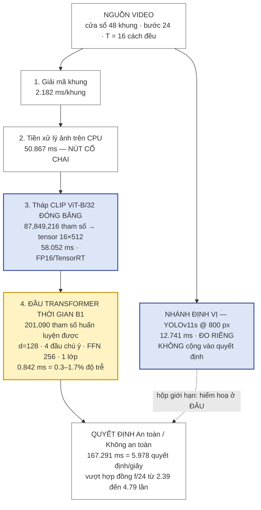
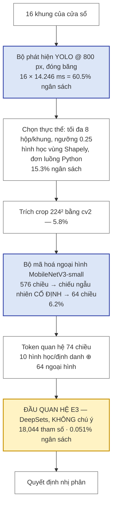
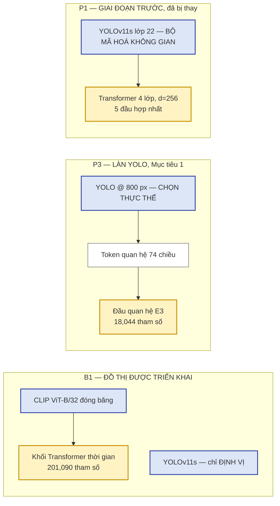

# BÁO CÁO GIẢI TRÌNH THAY ĐỔI SO VỚI ĐỀ CƯƠNG ĐÃ DUYỆT

**Kính gửi:** Giảng viên hướng dẫn — `[Học hàm, học vị, Họ tên GVHD]`
**Học viên:** `[Họ tên]` — `[Mã học viên]` — `[Lớp / Chuyên ngành]`
**Đề tài (theo đề cương đã duyệt):** *Phát hiện hành vi không an toàn trong thời gian thực trong
giám sát công nghiệp dựa trên YOLO và Transformer.*
**Ngày lập:** 10/10/2026 · **Mốc đóng băng số liệu:** 05/10/2026 · **Dự kiến bảo vệ:** giữa 10/2026

---

## 1. Mục đích của văn bản

Xin ý kiến và chữ ký duyệt của GVHD cho **năm thay đổi** so với đề cương đã đăng ký (mục 6), trước khi nộp
luận văn cho nhà trường.

Văn bản này **không** xin sửa đề cương. Đề cương giữ nguyên nguyên trạng. Luận văn khai các điểm
lệch ngay tại mục 1.4.2, trước mọi kết quả. Điều còn thiếu là **thủ tục**: một văn bản xác nhận
GVHD đã biết và đồng ý với các điểm lệch đó. Theo kết quả tự rà soát nội bộ, đây là hạng mục duy
nhất còn lại có thể ảnh hưởng mức ĐẠT/KHÔNG ĐẠT; mọi hạng mục khác chỉ ảnh hưởng điểm.

Các mục 2, 3 và 5 là phần nền được bổ sung theo yêu cầu: **kết quả** đã đo, **đóng góp** đã giao so
với đã rút, và **chương trình ứng dụng** tại nhà máy. Ba mục này không xin duyệt điều gì; chúng tồn
tại để GVHD và hội đồng biết chính xác luận văn giao cái gì, trước khi đọc năm thay đổi ở mục 6.

## 2. Kết quả chính của luận văn

### 2.1. Bảng kết quả tiêu đề — làn nhị phân

Bản nộp gồm 11 tệp tiếng Việt, 8 chương, khoảng 90,600 từ, đã viết xong.

| Hạng mục | Kết quả | Nguồn |
|---|---|---|
| Kết luận chính (phương pháp luận) | Lạm phát giao thức đo được trên **hai kho độc lập**: +13.0 → +21.8 pp (Unsafe-Net, 5 kiến trúc) và +10.4 → +15.4 pp (iSafetyBench, 4 bộ mã hoá) | §6.5, §6.6 |
| Đối chứng tách nguyên nhân | Giả dược 20 seed tách +15.4 pp thành **+1.6 pp do hình học fold** và **+13.8 pp do danh tính nguồn** (p hoán vị = 0.0476) | §6.6.3 |
| Độ chính xác cấu hình triển khai | **84.2%** cân bằng, leave-source-out, 1,100 clip, so đường sàn tiền đăng ký **63.3%** (không so 50%) | §6.2.1 |
| Cùng mô hình, chỉ đổi phép chia | **97.7%** dưới fold ngẫu nhiên, +13.5 pp, CI theo cụm [+8.0, +20.0], p = 1.39e-41 — **đo được và chọn không công bố làm tiêu đề** | §6.2.7 |
| Ma trận nhầm lẫn | Ba ma trận (nhị phân × hai giao thức; bốn lớp), tái lập độc lập mọi con số tiêu đề | §6.2.8, §6.12.4 |
| Cổng tiền đăng ký | 8 cổng viết **trước** khi có số: **2 đạt, 6 trượt**; cả 6 trượt đều được báo cáo | §6.13 |
| Triển khai biên (đo trên thiết bị) | Jetson Orin Nano Super, vòng lặp tổ hợp **167.291 ms**/quyết định trung vị = **5.978 quyết định/giây**, vượt hợp đồng nhịp 2.39–4.79 lần; khung hình không rời thiết bị | §5.4.4, §5.8 |
| Phân tích thất bại | Một chương riêng (Ch7) cho kết quả âm, số đã rút và khuyết điểm còn lại | Ch7 |

Điểm đáng lưu ý về liêm chính: luận văn **có** một con số chín mươi mấy phần trăm, đo được, có log,
có tệp dự đoán ngoài-fold 1,100 dòng — và **chọn không lấy nó làm tiêu đề** vì nó sinh ra từ giao
thức mà chính luận văn chứng minh là bị phồng.

### 2.2. Làn bốn lớp Unsafe-Net — làn gần bài toán nhà máy nhất

Làn tiêu đề ở mục 2.1 là bài toán **nhị phân**: an toàn / không an toàn. Làn gần nghiệp vụ nhà máy
nhất lại là làn **bốn lớp** trên Unsafe-Net, vì đó là làn duy nhất có **chú giải hộp giới hạn thật**
và **hình học vùng thật** (lối đi dành cho người đi bộ, vùng hạn chế). Bốn lớp đúng là bốn hiểm hoạ
nhà máy, và độ nhạy theo lớp là bảng mà hội đồng nên đọc trước con số tổng hợp (§6.12, Bảng 6.7):

| Lớp | Hiểm hoạ nhà máy | Transformer quan hệ | Đường sàn ngoại hình toàn khung | Chênh |
|---|---|---|---|---|
| WalkwayViol | người vi phạm lối đi dành cho người đi bộ | 70.5% | 17.6% | **+52.9 pp** |
| UnauthorInt | người không phép vào / can thiệp vùng hạn chế | 65.7% | 51.9% | **+13.8 pp** |
| OpenedPanel | tủ điện để mở | 88.7% | 88.0% | +0.7 pp |
| CarryOverload | xe nâng chở quá tải | 100.0% | 100.0% | 0.0 pp |

Tổng hợp làn này: **top-1 401/516 = 77.7%, macro 81.2%**, so đường sàn ngoại hình bối cảnh
**64.4%** → biên trung thực **+16.9 pp** (CI bootstrap [+12.5, +21.2], n_boot = 5,000).

Và đây là phần phải nói ra trước, chứ không để hội đồng tự tìm: **gần như toàn bộ biên nằm ở một
lớp.** WalkwayViol đóng +52.9 pp, UnauthorInt +13.8 pp; với hai lớp còn lại, một bộ phân lớp ngoại
hình toàn khung làm **ngang bằng** (88.0% so với 88.7%; 100.0% so với 100.0%). Đọc đúng: phân rã
theo thực thể chỉ có giá trị nghiệp vụ ở hiểm hoạ mà nhãn là một **quan hệ người–vùng hình học**;
ở hiểm hoạ mà nhãn là một **thuộc tính ngoại hình cục bộ** (tủ mở hay đóng, xe quá tải hay không)
thì nó không thêm gì. Kết quả này đúng theo chiều mà thiết kế dự đoán, và nó cũng là lời giải thích
nghiệp vụ cho phán quyết trượt của cổng G14.

Ba ràng buộc trích dẫn bắt buộc kèm bảng độ nhạy theo lớp: nó là bảng **mô tả, không có khoảng tin
cậy**; §6.9 ghi nhận bất ổn **tới khoảng 20 pp giữa các seed**, nên các con số này **không được dùng
để xếp hạng lớp**; và độ đồng thuận giữa hai người gán nhãn độc lập trên 100 clip chỉ đạt **κ = 0.65**
(đồng thuận thô 72%), đặt một **trần thực tế** cho mọi con số của làn này — không mô hình nào được
chứng nhận vượt quá độ nhất quán của nhãn mà nó học.

Hai ràng buộc trích dẫn bắt buộc của con số tổng hợp: (i) CI [+12.5, +21.2] là bootstrap trên **516 clip**,
**không** phải bootstrap theo cụm trên 8 nhóm bối cảnh — tức **đơn vị lấy mẫu sai**; nó được công bố
vì đã được tính và đã trích ở bản thảo trước, nhưng **không** dùng làm căn cứ chứng nhận. (ii) Biên
**+58.7 / +60.3 pp** từng xuất hiện ở bản thảo trước **đã bị rút**: đó là hiệu số so với bộ dự đoán
lớp đa số, và một bộ dự đoán lớp đa số không phải đường sàn cạnh tranh — nó là một phép chia.

### 2.3. Bốn điều mà một con số của luận văn KHÔNG có nghĩa

Mục này tồn tại để không ai — kể cả học viên khi trình bày — đọc 84.2% rộng hơn cái nó đo.

1. **84.2% không phải độ chính xác của vòng lặp chạy trên thiết bị.** Chương 6 lấy T = 16 khung cách
   đều trên **toàn clip**; vòng lặp triển khai lấy 16 khung trong một **cửa sổ 48 khung**. Chưa có
   lượt chạy nào đo độ chính xác dưới phép lấy mẫu theo cửa sổ (§5.9 hạng mục 15).
2. **84.2% không dự báo một nhà máy mới.** Dải cân bằng theo fold là **29.7 pp**. Một con số tổng hợp
   mô tả **kho dữ liệu**, không mô tả một hiện trường chưa gặp.
3. **Xác suất thô của mô hình chưa dùng được để đặt ngưỡng.** ECE (15 bin) = **0.097** — độ tin cậy
   lệch khỏi độ chính xác thực tế khoảng 9.7 điểm phần trăm. Con số này thuộc **thẻ điểm của làn
   bốn lớp** (64 clip, §6.12.4), **không** phải của B1; không có ECE nào được công bố cho làn tiêu
   đề. Hệ quả vẫn giữ nguyên chiều: trước khi hiệu chuẩn tại hiện trường, ngưỡng phải đặt theo
   **thứ hạng**, không theo giá trị xác suất tuyệt đối (§8.3.1).
4. **84.2% và 95.81% không so được với nhau**: hai kho rời nhau, hai bài toán, hai thước đo — luận
   văn **cấm** đặt chúng vào cùng một câu (§6.1.1).

## 3. Đóng góp: đã giao, đã rút, và đâu là "đóng góp" theo nghĩa hẹp

Mục này là bản rút gọn của Bảng 8.1 (§8.2.2 của luận văn). Bảng đó được đặt ở **chương kết luận**,
không ở phụ lục, vì cột thứ hai của nó cũng là một phần kết quả.

### 3.1. Sáu đóng góp đã giao

| # | Đóng góp | Bằng chứng |
|---|---|---|
| 1 | **Phép đo lạm phát giao thức, tái lập độc lập trên hai kho** với hai định nghĩa nhóm khác nhau, kèm chứng minh rằng lạm phát **xoá khả năng phân biệt kiến trúc**; kèm kiểm tra nhiễm chéo giữa hai kho bằng băm tri giác: **0 trùng khớp** | §6.5, §6.6, §6.11.4 |
| 2 | **Một hệ thống quyết định chạy trên thiết bị biên 249–499 USD**, đo bằng *quyết định/giây*, dưới **hai** điều kiện xung nhịp, với **bốn điều kiện trích dẫn** áp dụng hồi tố và một **danh sách những gì chưa được đo** | §5.2, §5.9 |
| 3 | **Giao thức đánh giá tiền đăng ký**: 8 cổng + 3 đối chứng, hệ quả nhận trước cho từng phán quyết trượt, và **6 phán quyết trượt được công bố ở mức chi tiết ngang 2 phán quyết đạt** | §3.8, §6.13 |
| 4 | **Phân tích kết quả phủ định có quy nguyên nhân**: cơ chế của việc phân rã thực thể không thắng; một thất bại tập trung theo fold và việc nó **di chuyển**; một phép cộng từng được trình bày như một phép đo | Ch7 |
| 5 | **Hạ tầng truy xuất xuất xứ**: mỗi con số công bố có một dòng chỉ tới tệp đã sinh ra nó, kèm trạng thái đã đối chiếu hay chưa; cấu hình fold đầy đủ kèm dấu vết nhận dạng giao thức | Phụ lục A, B |
| 6 | **Sổ đăng ký các phát biểu đã rút** — danh mục công khai những con số từng được trình bày và đã bị rút, kèm lý do | §7.6 |

### 3.2. Năm hạng mục đã rút hoặc không được giao

| # | Hạng mục | Trạng thái |
|---|---|---|
| 7 | **Đóng góp kiến trúc theo hướng phân rã thực thể** | **Không được giao.** Ba cổng cùng trượt (G14, G17, G18). Đây là phần lớn nhất của đề cương không được số liệu ủng hộ (§8.2.1) |
| 8 | **RT-DETR làm bộ mã hoá thời gian** | Không dùng — lý do kỹ thuật ở §3.1.3 cộng kết quả phủ định của thí nghiệm sơ bộ, **không** phải lý do tiện lợi |
| 9 | **Tinh chỉnh ở quy mô bài báo gốc trên chú giải hộp theo từng khung** | Không thực hiện được: chú giải không được công bố. Thí nghiệm thử ở quy mô 400 khung được báo cáo như **kết quả phủ định** (§1.6) |
| 10 | **Các phát biểu đã rút**, mỗi phát biểu kèm lý do | Một tập hợp chọn theo tập kiểm thử; một phép hiệu chuẩn dò trên chính tập kiểm thử (P1); hai biên **+60.3** và **+58.7 pp** so bộ phân lớp hằng số; một hằng số đường cơ sở sai khiến **55/64** bị dùng thay **57/64**; một tổng giai đoạn **144.9 ms** từng được trình bày như độ trễ quyết định; và mọi phát biểu "còn dư bao nhiêu watt" vì mẫu số không xác định (§7.6) |
| 11 | **Con số 95.81% của bài báo gốc trên Unsafe-Net** | Luận văn **không đạt và không tuyên bố đạt**. Định vị so với công trình đó không phải khoảng cách độ chính xác mà là phép đo **bao nhiêu phần của một con số như vậy do giao thức sinh ra** (§2.6, §6.12.5) |

Hai phát biểu về bảng trên. Thứ nhất, **cột "đã rút" không phải một lời xin lỗi mà là một phần kết
quả**: nếu đề cương nêu một giả thuyết và số liệu phản chứng nó, thì công bố phản chứng ở mức chi
tiết đầy đủ chính là đóng góp. Thứ hai, **quyết định triển khai đi theo bằng chứng chứ không theo đề
cương**: lý do Chương 5 triển khai một tháp toàn khung mà không triển khai đường thực thể nằm đúng ở
hàng (7).

### 3.3. Phân định bắt buộc: đâu là đóng góp, đâu là cấu hình kỹ thuật tiêu chuẩn

Nếu không nêu ranh giới này thì một bảng đối chiếu hiểm hoạ sẽ **trông như** năm đóng góp nghiên cứu
trong khi chỉ có hai (§5.8.2):

- **Là đóng góp kiến trúc của luận văn, và được đo:** (T1) suy luận hoàn toàn tại biên — khung ảnh
  thô không bao giờ rời thiết bị; (T5) cảnh báo **hai ngưỡng** trên cửa sổ trượt.
- **Là cấu hình vận hành tiêu chuẩn, liệt kê cho đủ chứ không nhận là mới:** (T2) engine TensorRT
  gắn với thiết bị; (T3) truyền bằng SSH chỉ dùng khoá; (T4) kiểm soát truy cập.
- **Kiến trúc CHỦ Ý không cung cấp:** chứng thực chống can thiệp (tamper-evident attestation) và ký
  số mô hình. Đây là **phạm vi đã chọn**, không phải thiếu sót bị bỏ quên.

Một phân định nữa, bất lợi và vẫn phải nêu: **lợi ích 84.2% là một khoản "mua xương sống", không
phải một thiết kế đầu phân lớp.** Đầu của B1 (201,090 tham số) **nhỏ hơn** đầu E0 (298,118) mà nó
vượt; thứ thay đổi là tháp thị giác đóng băng ở phía dưới (§6.2.6). Và biên của B1 so với encoder
thực thể tốt nhất có khoảng tin cậy theo cụm **chứa 0**. Vì vậy luận văn phát biểu 84.2% như một
**phép đo**, và **không** phát biểu "biểu diễn toàn khung tốt hơn biểu diễn thực thể" như một kết
luận được chứng nhận (§8.1.3).

## 4. Mô tả kỹ thuật và kiến trúc hệ thống

Mục này trả lời đúng câu hỏi mà tên đề tài đặt ra: **YOLO nằm ở đâu, Transformer nằm ở đâu, và mỗi
cái dùng để làm gì.** Đặc tả đầy đủ ở Chương 3 của luận văn; mục này là bản rút gọn có sơ đồ.

### 4.1. Sơ đồ kiến trúc tổng quan — đường quyết định đã triển khai (B1)

```
  ┌──────────────────────────────────────────────────────────────────────────────────┐
  │  NGUỒN VIDEO  — luồng liên tục, 15 / 25 / 30 / 60 khung/giây (đo trên 1,100 clip)│
  │  Cửa sổ quyết định 48 khung  ·  bước nhảy 24 khung  ·  T = 16 khung cách đều     │
  └───────────────────────────────────┬──────────────────────────────────────────────┘
                                      v
   [1]  GIẢI MÃ KHUNG (NVDEC/CPU)                              2.182 ms / khung
                                      v
   [2]  TIỀN XỬ LÝ ẢNH (CPU)                                  50.867 ms  ← nút cổ chai
        resize → chuẩn hoá → xếp lô 16 khung                              hạng mục CHI PHỐI
                                      v
   [3]  THÁP THỊ GIÁC  CLIP ViT-B/32  **ĐÓNG BĂNG**           58.052 ms (trong vòng lặp)
        87,849,216 tham số · không cập nhật gradient                      (FP16 / TensorRT)
        16 khung → tensor (16, 512)
                                      v
   [4]  **ĐẦU TRANSFORMER THỜI GIAN B1** — phần luận văn        0.842 ms  = 0.3–1.7% độ trễ
        thực sự thiết kế · 201,090 tham số huấn luyện được
        (16,512) → Linear(512→128) → khối Transformer 1 lớp
        → token [CLS] → LayerNorm → Linear(128→2)
                                      v
   ┌──────────────────────────────────────────────────────────────────────────────────┐
   │  QUYẾT ĐỊNH  An toàn / Không an toàn                                             │
   │  167.291 ms mỗi quyết định (trung vị)  =  **5.978 quyết định/giây**              │
   │  Hợp đồng nhịp = f/24 → vượt 4.79 lần (clip trung vị) · 2.39 lần (clip 60 fps)   │
   └──────────────────────────────────────────────────────────────────────────────────┘

   [5]  NHÁNH ĐỊNH VỊ — chạy song song, **ĐO RIÊNG, KHÔNG cộng vào quyết định**
        **YOLOv11s @ 800 px**  →  hộp giới hạn: trả lời "hiểm hoạ ở ĐÂU"  12.741 ms

   Ranh giới dữ liệu: cả [1]–[5] nằm **trên thiết bị biên**. Khung hình không bao giờ rời
   thiết bị; chỉ nhãn quyết định và hộp giới hạn đi ra ngoài (mục 5.8 của luận văn).
```

### 4.2. Ba đồ thị tính toán — và vì sao không được trộn số của chúng

Luận văn đo **ba** đồ thị khác nhau. Đây là bảng định nghĩa (tương ứng Bảng 5.1 của luận văn):

| Ký hiệu | Đồ thị | Đơn vị đo | Tập đánh giá | Vai trò |
|---|---|---|---|---|
| **B1** | 16 khung → tháp **CLIP ViT-B/32** đóng băng (87,849,216 tham số, 512 chiều) → **đầu Transformer thời gian** (201,090 tham số; 603,270 cho tập 3 hạt giống) | quyết định/giây | iSafetyBench, 1,100 clip, leave-source-out, 151 nguồn | **ĐƯỢC TRIỂN KHAI** — sinh kết quả tiêu đề, được xuất TensorRT và đo nhịp |
| **P3** | bộ phát hiện **YOLO** @ 800 px → chọn thực thể bằng hình học vùng (Shapely) → crop 224² → bộ mã hoá ngoại hình → **đầu quan hệ E3** (18,044 tham số) | quyết định/giây | Unsafe-Net, 687 clip, leave-context-out, 8 nhóm bối cảnh | **LÀN YOLO** — deliverable của Mục tiêu 1, đo trên Jetson để trả lời câu hỏi **chi phí** |
| **P1** | xương sống **YOLOv11s đóng băng** (lớp 22, khối C3k2) → cửa sổ T = 32 → 4 luồng thời gian + MLP cổng → Transformer 4 lớp → 5 đầu hợp nhất | khung/giây | 64 clip, 4 lớp | **GIAI ĐOẠN TRƯỚC** — chỉ còn giữ 2 số đo, đều dán nhãn phạm vi |

Ba đơn vị đo **không quy đổi được cho nhau**: "khung/giây" đếm khung mà xương sống xử lý;
"quyết định/giây" đếm phán quyết ở mức cửa sổ, mỗi phán quyết tiêu thụ 16 khung. Một hệ đạt
116 khung/giây có thể chỉ phát 3 quyết định/giây, và hai con số đó **không** mâu thuẫn. Quy tắc có
hiệu lực toàn luận văn: không bao giờ lấy trung bình, so sánh, hay đặt vào cùng một câu hai con số
thuộc hai đơn vị khác nhau.

### 4.3. YOLO dùng ở đâu, để làm gì

Đây là bảng mà hội đồng sẽ hỏi tới trước tiên, vì tên đề tài có chữ YOLO.

| # | Vai trò của YOLO | Mô hình | Dùng ở đâu | Có trong đồ thị triển khai? |
|---|---|---|---|---|
| 1 | **Định vị** — chỉ ra hiểm hoạ ở đâu trong khung, phục vụ hiển thị và can thiệp | YOLOv11s @ 800 px | Nhánh song song của hệ triển khai, đo riêng 12.741 ms | **CÓ** — nhưng không tham gia quyết định phân lớp |
| 2 | **Chọn thực thể** — sinh tối đa N_MAX = 8 hộp tin cậy nhất mỗi khung (ngưỡng 0.25) để dựng token quan hệ | YOLOv11s (tiêu đề) · YOLO26s (đối chứng G17) | Làn quan hệ thực thể: token 74 chiều (P3, Unsafe-Net) và token CLIP 512 chiều (iSafetyBench) | **CÓ trong P3**, không trong B1 |
| 3 | **Bộ mã hoá không gian** — lấy đầu ra lớp 22 (khối C3k2) làm đặc trưng khung | YOLOv11s đóng băng | Đồ thị P1 của giai đoạn trước | Không — P1 đã bị thay |

Ba điều phải nói thẳng về YOLO:

- **YOLO không bị bỏ.** Nó giữ vai trò 1 trong chính hệ đang chạy, và là bước đầu của toàn bộ làn
  P3 — nơi nó chiếm **60.5%** ngân sách một quyết định (16 khung × 14.246 ms, Bảng 5.5).
- **YOLO không nằm trong quyết định phân lớp của cấu hình tiêu đề.** Lý do là ba cổng phủ định hội
  tụ: phân rã theo thực thể không hơn toàn khung (G14), thế hệ bộ phát hiện không đổi kết luận
  (G17), hợp nhất hai luồng không thêm giá trị (G18). Đồ thị quyết định vì vậy **không tiêu thụ hộp
  giới hạn** — đó là một kết luận đo được, không phải một hạng mục bị bỏ sót.
- **Bộ phát hiện tiêu đề là YOLOv11s và được đóng băng theo quy tắc tiền đăng ký**, bất kể đối
  chứng G17 cho kết quả gì. YOLO26s trả về ít phát hiện hơn 14.1% ở cùng ngưỡng (45,512 so với
  52,997); tỉ lệ khung có ít nhất một phát hiện là 90.2% (v11s) so với 87.9% (26s).

### 4.4. Transformer dùng ở đâu, để làm gì

**Một khối Transformer thời gian duy nhất, dùng chung ở mọi nhánh** — cùng một lớp mã nguồn, không
phải hai bản cài đặt song song. Đây là điều kiện làm cho mọi đối chứng của Chương 6 hợp lệ.

```
   Đầu vào: 16 trạng thái khung  (từ tháp CLIP, hoặc từ giai đoạn thực thể)
        │
        ├── bảng vị trí thời gian **học được**, 16 khe
        ├── token **[CLS]** học được  (gộp bằng chú ý, không gộp bằng trung bình)
        │
        v
   ┌─────────────────────────────────────────────────────────────────┐
   │  Bộ mã hoá Transformer                                           │
   │    chiều mô hình d = 128   ·  số đầu chú ý = 4                   │
   │    chiều FFN      = 256    ·  số lớp = 1 (B1, ESTA) / 2 (B1w)    │
   │    dropout = 0.1  ·  norm_first = True  ·  kích hoạt GELU        │
   │    mặt nạ `valid` đánh dấu khung mang thông tin                  │
   └─────────────────────────────────┬───────────────────────────────┘
                                     v
        LayerNorm trên [CLS]  →  Linear(128 → 2)  →  An toàn / Không an toàn
```

Xử lý biên có chủ ý: một clip mà **mọi** khung đều không hợp lệ sẽ quay về chú ý trên toàn bộ các
khung thay vì phát ra NaN — một hàng softmax bị che hoàn toàn là không xác định, cách xử lý này đổi
giá trị không xác định thành giá trị xác định và bảo thủ.

**Các kiến trúc Transformer đã xây và đo** (mỗi kiến trúc tồn tại để trả lời một câu hỏi phản
biện cụ thể, và được cố định **bằng quy tắc trước khi huấn luyện**, không chọn theo điểm số):

| Mô hình | Cơ chế | Tham số | Tồn tại để trả lời |
|---|---|---|---|
| **B1** | toàn khung: `Linear(512→128)` → khối thời gian 1 lớp → `Linear(128→2)` | 201,090 | Cấu hình **được triển khai**; chọn theo tiêu chí *nhỏ nhất*, không theo độ chính xác |
| **B1w** | như B1, khối thời gian **2 lớp** | 333,570 | Đối chứng **khớp dung lượng** với ESTA — để thắng lợi của nhánh thực thể không đọc được là "nó chỉ lớn hơn" |
| **B1xl** | d = 192, FFN = 384, 2 lớp | 696,962 | Đối chứng dung lượng của G18; chọn bằng số tham số, ra kết quả **lớn hơn** đối thủ 1.5% |
| **B2** | xương sống **VideoMAE-base** (Kinetics) → **cùng khối thời gian** của B1 | 233,858 | Đối thủ **mạnh và trung thực** của G16: khác B1 **chỉ** ở xương sống |
| **ESTA** | hai giai đoạn: chú ý **trong khung** trên 8 thực thể → `frame_cls` → khối thời gian | 352,258 | Giả thuyết trung tâm: phân rã theo thực thể (cổng G14) |
| **E0–E3** | thang encoder quan hệ trải **17 lần** dung lượng trên token 74 chiều | 17,270 → 298,892 | Khiếm khuyết nằm ở cơ chế hay ở tiên nghiệm vị trí (E2 cô lập đúng một biến) |
| **TSF** | hợp nhất hai luồng **học bên trong mô hình**, có đầu phụ λ = 0.3 mỗi nhánh | 686,726 | Phân rã thực thể có **bổ sung** cho toàn khung không (cổng G18) |

**Đầu quan hệ tiêu đề của làn P3 là E3 — DeepSets, không chú ý ở bất kỳ đâu, 18,044 tham số.** Nó
được cố định làm encoder tiêu đề **trước** khi bảng kết quả tồn tại, theo tiêu chí triển khai "nhỏ
nhất của thang". Nếu một encoder khác về sau cho điểm cao hơn, điều đó **không** làm nó thành
encoder tiêu đề — đổi encoder sau khi thấy bảng kết quả chính là hành vi mà toàn bộ giao thức của
luận văn được viết ra để chống lại.

### 4.5. Sơ đồ làn P3 — deliverable của Mục tiêu 1 (YOLO–Transformer)

```
   16 khung của cửa sổ
        v
   [1] BỘ PHÁT HIỆN YOLO @ 800 px, đóng băng          16 × 14.246 ms → **60.5%** ngân sách
        v   giữ ≤ N_MAX = 8 thực thể/khung, ngưỡng tin cậy 0.25
   [2] HẬU XỬ LÝ — chọn thực thể bằng hình học vùng (Shapely, đơn luồng Python)   **15.3%**
        v   iou_walkway · iou_restricted · foot_in_walkway · norm_dist
   [3] TRÍCH CROP 224² (cv2)                                                        5.8%
        v
   [4] BỘ MÃ HOÁ NGOẠI HÌNH — MobileNetV3-small (ImageNet)                          6.2%
        v   576 chiều → **phép chiếu ngẫu nhiên CỐ ĐỊNH** → 64 chiều
   [5] TOKEN QUAN HỆ 74 chiều = 10 (hình học/định danh) ⊕ 64 (ngoại hình)
        v
   [6] ĐẦU QUAN HỆ **E3 (DeepSets)**, 18,044 tham số                            **0.051%**
        v   gộp trung bình có mặt nạ → MLP theo khung → gộp mean‖max theo thời gian
        QUYẾT ĐỊNH nhị phân
```

Hai điều phải khai kèm làn này:

- **Hợp đồng nhịp của P3 khác hợp đồng của B1** vì bước nhảy khác (P3 phát mỗi 8 khung, B1 mỗi 24
  khung). Ở nguồn 24 khung/giây, hợp đồng của P3 là 3.0 quyết định/giây. Dưới điều kiện xung nhịp
  **mặc định (DVFS)**, P3 **không đạt** hợp đồng này (mục 5.1.1, mục 5.5). Số nhịp của hai làn
  **không bao giờ** được so với nhau.
- **Phép chiếu ngẫu nhiên cố định 576 → 64 là một cổ chai đã được khai ở mục phương pháp**, không
  khai muộn ở phần thảo luận: phần ngoại hình của token này không phải một biểu diễn ngữ nghĩa mạnh.
  Do đó một phán quyết trượt của cổng G11 **không** chứng minh phân rã theo thực thể vô dụng ở
  biểu diễn mạnh hơn — nó chỉ chứng minh điều đó **ở biểu diễn 64 chiều này**.

### 4.6. Kết luận kỹ thuật quan trọng nhất của phần triển khai

| Đường | Phần luận văn **tự thiết kế** | Chi phí của nó | Hạng mục chi phối thực tế |
|---|---|---|---|
| B1 | đầu Transformer thời gian, 201,090 tham số | **0.3–1.7%** độ trễ một quyết định | tiền xử lý ảnh trên **CPU** |
| P3 | đầu quan hệ E3, 18,044 tham số | **0.051%** ngân sách quyết định | bộ phát hiện (60.5%) + hậu xử lý hình học trên **CPU** (15.3%) |

Hai kiến trúc độc lập, cùng một kết luận: **chi phí triển khai của một hệ phát hiện hành vi không
an toàn hoàn toàn không nằm ở bộ phân lớp thời gian; nó nằm ở việc "nhìn". Trên thiết bị biên này,
nút cổ chai của cả hai kiến trúc đều là CPU — không phải GPU, và không phải mô hình.**

Đây là một kết luận **bất lợi cho tầm quan trọng của đóng góp riêng** của luận văn, và nó được nêu
ở ngay đầu Chương 5 chứ không bị chôn ở phần hạn chế.

## 5. Chương trình ứng dụng: phát hiện hành vi không an toàn trong nhà máy

Mục này trả lời câu hỏi "hệ thống này dùng được ở nhà máy như thế nào" bằng **đúng những gì đã tồn
tại trong kho mã và đã chạy**, kèm một danh sách khai thẳng những gì chưa có (mục 5.5). Ranh giới
giữa hai phần đó là phần quan trọng nhất của mục này.

### 5.1. Kiến trúc triển khai bốn lớp tại nhà máy

Ranh giới giữa lớp thứ hai và lớp thứ ba **đồng thời là ranh giới bảo vệ dữ liệu** (§5.8.1):

```
  [CAMERA NHÀ MÁY / tệp video thay thế]  ──(khung RGB)──>
  ┌──────────────────────────────────────────────────────────────────────────────────┐
  │  LỚP 2 — BIÊN: Jetson Orin Nano Super (249–499 USD), đặt tại xưởng               │
  │    bộ đọc video bất đồng bộ → hàng đợi tiền xử lý → suy luận engine TensorRT      │
  │    → cửa sổ trượt 48 khung / bước 24 → hợp nhất → ghi dòng sự kiện JSONL          │
  └──────────────────────────────────────────────────────────────────────────────────┘
  ═════════ RANH GIỚI RIÊNG TƯ: khung ảnh thô KHÔNG vượt qua đường này ═════════
            (SSH chỉ dùng khoá · AES-128-CTR + HMAC-SHA-256 — mặc định của rsync)
  ┌──────────────────────────────────────────────────────────────────────────────────┐
  │  LỚP 3 — MÁY CHỦ: bộ đệm JSONL → tổng hợp trượt 3 giây theo từng luồng            │
  │  LỚP 4 — BẢNG ĐIỀU KHIỂN: conf ≥ 0.75 BÁO ĐỘNG │ ≥ 0.55 CẢNH BÁO │ còn lại GIÁM SÁT│
  │           → hiển thị cho người vận hành an ninh                                   │
  └──────────────────────────────────────────────────────────────────────────────────┘
```

Phát biểu riêng tư là một phát biểu **kiến trúc**, không phải một phát biểu chính sách: khung ảnh
thô không vượt ranh giới **vì không có đường dẫn nào để chúng vượt** — chỉ bản ghi sự kiện được ghi
ra và đồng bộ đi. Đây là lý do phát biểu này **chuyển được giữa cả ba pipeline**: nó không phụ thuộc
mô hình nào tính quyết định, chỉ phụ thuộc việc cái gì được phép vượt ranh giới. Sơ đồ gốc mô tả đồ
thị P1; đường đã triển khai nay là B1, và ranh giới **không đổi**.

### 5.2. Các chương trình đã có trong kho mã

| Chương trình | Dòng | Làm gì | Trạng thái |
|---|---|---|---|
| `demo/run-unsafe-behavior-demo.py` | 166 | Trượt cửa sổ trên một video → xuất **video có chú thích** `.mp4` + **dòng thời gian** `.json` | Chạy được; **9/9 test đạt** (`tests/test-demo-b1-pipeline.py`, chạy lại 10/10/2026) |
| `demo/b1-window-pipeline.py` | 133 | Lõi suy luận cửa sổ trượt của đường B1 đã triển khai; **từ chối** checkpoint nhánh thực thể thay vì nhồi số 0 cho phần crop mà nó đòi | Chạy được, có test |
| `deployment/scripts/jetson-multi-stream-pipeline.py` | 199 | Chạy **trên thiết bị**: phát một sự kiện JSON mỗi lần suy luận ra tệp JSONL | Đã chạy trên Jetson — **đầu `direct4-s314` của giai đoạn P1, bốn lớp** |
| `deployment/dashboard/jetson-live-monitor.py` | 367 | Bảng điều khiển người vận hành: kéo JSONL qua rsync/SSH, tổng hợp trượt 3 giây, dán nhãn BÁO ĐỘNG / CẢNH BÁO / GIÁM SÁT | Chạy được (Streamlit) — **tiêu thụ dòng sự kiện bốn lớp của P1** |
| `deployment/dashboard/app.py` | 198 | Streamlit: xem một video + lưới 2×2 bốn luồng, suy luận ONNX, chọn FP32/INT8 | Chạy được — **giai đoạn P1, bốn lớp**, **chưa** đổi dây sang B1 |

Trọng số được triển khai: `sweep_results/relation_tokens/deploy/b1-deploy-3seed.pt` — **2.4 MB**,
tập **3 hạt giống**.

**Phân định phải nói ngay, vì nó quyết định cách đọc cả mục 5:** trong năm chương trình trên, **chỉ
hai chương trình đầu phục vụ đường B1 đã triển khai** (nhị phân, an toàn / không an toàn). **Ba
chương trình còn lại — bộ phát sự kiện trên thiết bị và cả hai bảng điều khiển — đều là của giai
đoạn P1, bốn lớp** (`direct4-s314`, `scenario-s7`). Tức **chuỗi phục vụ lớp 3 và lớp 4 ở mục 5.1
chưa được đổi dây sang cấu hình tiêu đề**: nó đã chạy, nhưng chạy bằng mô hình của giai đoạn trước.
Điều **không** đổi khi đổi dây là **ranh giới riêng tư** — nó phụ thuộc việc cái gì được phép vượt
ranh giới, không phụ thuộc mô hình nào tính quyết định (§5.8.1).

Bốn quyết định thiết kế của chương trình demo mà hội đồng sẽ hỏi tới, và lý do của từng cái:

- **Ngưỡng quyết định cố định 0.5 và CHƯA BAO GIỜ được tinh chỉnh.** Không ngưỡng nào từng được
  chọn trên kho này; chọn một ngưỡng riêng cho demo sẽ làm demo **không khớp** với con số đã báo
  cáo. Xác suất được hiển thị cạnh phán quyết để biên độ **nhìn thấy được**, thay vì bị che sau
  một nhãn.
- **Bộ phát hiện chỉ làm định vị và KHÔNG là đầu vào của quyết định phân lớp.** Cờ
  `--no_localisation` tắt hẳn bộ phát hiện và các xác suất phải ra **y nguyên** — đó chính là điều
  được kiểm bằng test. Nếu nối hộp giới hạn trở lại quyết định thì demo sẽ bất đồng với con số đã
  công bố, vì G14/G17/G18 đã kết luận nhánh thực thể không thêm độ chính xác.
- **Cửa sổ 48 khung, bước 24, T = 16, và tháp CLIP cùng phép tiền xử lý được IMPORT từ bộ dựng đặc
  trưng** thay vì cài lại — để demo **không thể âm thầm trôi** khỏi thứ đã được đo.
- **Đầu ra là một dòng thời gian kiểm toán được, không phải một nhãn.** Mỗi cửa sổ ghi:
  `prob_unsafe`, xác suất **của từng hạt giống**, phán quyết, số khung thực sự giải mã được, và bản
  tóm tắt định vị (số hộp và lớp của chúng) — để người đọc **thấy được** bộ phát hiện bất đồng với
  bộ phân lớp, thay vì sự bất đồng đó bị lấy trung bình cho mất.

### 5.3. Chính sách cảnh báo hai ngưỡng — và giới hạn của nó

Tổng hợp theo từng luồng trên **3 giây gần nhất** (lấy trung bình vector xác suất rồi mới argmax,
nên bền với nhiễu một khung), sau đó: **≥ 0.75 → BÁO ĐỘNG**, **0.55–0.75 → CẢNH BÁO**, còn lại →
**GIÁM SÁT**. Luận văn tính cơ chế này là đóng góp kiến trúc **T5** (mục 3.3).

Giới hạn phải khai kèm: **hai ngưỡng 0.75 / 0.55 chưa được hiệu chuẩn tại bất kỳ hiện trường nào.**
Với ECE = 0.097 (làn bốn lớp, §6.12.4) và dải cân bằng theo fold **29.7 pp**, §8.3.1 xếp "hiệu chuẩn
và đặt ngưỡng theo hiện trường" là hạng mục phát triển **thứ nhất** của luận văn. Trước khi làm thủ tục đó, hai ngưỡng này là **giá trị
mặc định kỹ thuật**, không phải điểm vận hành đã được chứng nhận — và ngưỡng phải đặt theo **thứ
hạng** chứ không theo giá trị xác suất tuyệt đối.

### 5.4. Lợi ích định lượng cho một nhà máy

| Chỉ tiêu | Con số đã đo | Ý nghĩa với nhà máy |
|---|---|---|
| Chi phí đường lên | **221.0 byte/sự kiện · 11.64 sự kiện/giây ≈ 20.6 kbps** — đo trên 8,988 sự kiện thật trong 772.145 giây; bản ghi là bản ghi của **dòng sự kiện bốn lớp P1** (xem mục 5.2) | So với một luồng H.264 1080p cần 5–10 Mbps → kiến trúc biên **giảm nhu cầu đường truyền 240–480 lần** |
| Quyền riêng tư | Khung ảnh thô **không rời thiết bị**; chỉ siêu dữ liệu đi ra | Lập luận kiến trúc, dùng được cả nơi quy định nội bộ cấm truyền hình ảnh người lao động ra ngoài xưởng |
| Phần cứng | Jetson Orin Nano Super, **249–499 USD**/điểm giám sát | Triển khai được ở nơi hạ tầng mạng yếu, không cần đường truyền video về trung tâm |
| Nhịp | **167.291 ms/quyết định = 5.978 quyết định/giây**, biên **2.39–4.79 lần**; nguồn 1920×1080 đo riêng: **4.401 qđ/giây**, biên **1.76 lần** | Hệ **không bị nghẽn** bởi luồng video nó đọc |
| Nhiệt / công suất của vòng lặp đã triển khai | **KHÔNG CÓ SỐ** | Xem cảnh báo thứ hai dưới đây — đây là một ô trống thật, không phải một ô bị bỏ quên |

**Cảnh báo thứ nhất, kèm dòng "Nhịp".** Hợp đồng nhịp được dẫn từ **phân bố tần số khung của
chính kho dữ liệu** (*f*/24), **không** từ một tiêu chuẩn an toàn lao động nào. Nó nói hệ thống
không bị nghẽn bởi luồng video; nó **không** nói hệ thống phản ứng đủ nhanh cho một hiểm hoạ cụ thể.
Yêu cầu thời gian phản ứng thật của một ứng dụng an toàn phụ thuộc hiểm hoạ và chi phí can thiệp tại
hiện trường — một đại lượng luận văn **không** đo.

**Cảnh báo thứ hai: không được trích số nhiệt/công suất nào cho ứng dụng này.** Soak 36.2 phút với
0 sự kiện giảm tốc nhiệt, 7.03 W trung bình và 55.9 °C thuộc **mục 5.6 — tức số LỊCH SỬ của giai
đoạn P1**, và luận văn quy định rõ: **không con số nào trong mục 5.6 được dùng để chống đỡ một kết
luận**. Riêng bảng soak đó còn mang hai khiếm khuyết đã khai (K2: con số "≈ 107,000 khung" không có
trường tương ứng trong tạo tác; K3: "± 0.9 °C" không phải trường được ghi — dải thật là
52.375–56.812 °C). Thêm nữa, **mọi** con số công suất của luận văn chỉ được dùng để nói công suất
tuyệt đối ở một hệ số hoạt động đã nêu, **không** được dùng để lập luận về ngân sách nhiệt hay chế
độ nguồn (§5.6.5). Hệ quả cho mục này: **độ bền nhiệt và năng lượng mỗi quyết định của vòng lặp B1
đã triển khai là chưa biết** (§5.9 hạng mục 4 và 5).

### 5.5. Những gì chương trình ứng dụng CHƯA có — khai trước hội đồng

1. **Chưa có video demo nào được quay.** Nếu hội đồng yêu cầu demo trực tiếp, cần chuẩn bị riêng —
   xem câu hỏi 3 ở mục 9.
2. **Chưa đo độ chính xác của vòng lặp cửa sổ trượt.** Luận văn nói rõ phép đo này **khả thi trên
   máy chủ bằng chính chương trình `demo/run-unsafe-behavior-demo.py`**, không cần thiết bị; nó chưa
   được thực hiện vì nằm **sau mốc đóng số 05/10/2026** (§5.9 hạng mục 15). Treo vào đây: mọi con số
   độ chính xác của luận văn **không** được đọc là độ chính xác của vòng lặp trên thiết bị.
3. **Chưa đo trên camera công nghiệp thật, trong nhà máy thật.** Toàn bộ Chương 5 đo trên **tệp
   video**; không có số nào là số đo thực địa, và nguồn trực tiếp từ camera chưa được đo (§5.9 hạng
   mục 1 và 14) — nên chưa có chi phí tiếp nhận luồng mạng, chưa có jitter của nguồn.
4. **Độ bền 30 phút của chính vòng lặp B1 chưa đo.** Hai phép soak đã chạy đều chỉ nạp **một giai
   đoạn** (bộ phát hiện P3); độ bền của tháp CLIP **hoàn toàn chưa biết** (§5.9 hạng mục 4).
5. **Chưa có phát biểu "hệ thống phục vụ được N camera".** Kết quả 4 luồng thuộc giai đoạn P1 và
   **không chuyển được** sang B1/P3; đa luồng của B1 chưa đo (§5.9 hạng mục 6).
6. **Toàn bộ chuỗi phục vụ lớp 3 – lớp 4 còn chạy mô hình bốn lớp của giai đoạn P1**, chưa đổi dây
   sang B1: cả bộ phát sự kiện trên thiết bị, cả hai bảng điều khiển. Việc đổi dây là **công việc
   kỹ thuật, không phải kết quả**, và **không** được tính vào đóng góp. Hệ quả: hiện **chưa tồn tại
   một lần chạy đầu-cuối nào** từ camera tới bảng điều khiển bằng chính cấu hình tiêu đề B1.
7. **Hiệu chuẩn và đặt ngưỡng theo hiện trường chưa làm**, và câu hỏi quyết định tính khả thi —
   *cần bao nhiêu clip có nhãn tại mỗi hiện trường để ngưỡng ổn định?* — **chưa xác định**. Với
   κ = 0.65 ở mức chú giải, chi phí gán nhãn tại hiện trường không nhỏ (§8.3.1).

## 6. Năm thay đổi xin GVHD duyệt

### (a) Tháp thị giác của cấu hình **tiêu đề**: YOLO → CLIP ViT-B/32 đóng băng

Đây là thay đổi nặng nhất, và là **dòng đầu tiên** của bảng tự khai §1.4.2.

- **Lý do:** cổng tiền đăng ký **G14 TRƯỢT**. Giả thuyết "phân rã theo thực thể dựa trên bộ phát
  hiện làm tăng độ chính xác so với đường cơ sở toàn khung khớp dung lượng" cho **−0.5 pp**, khoảng
  tin cậy theo cụm **[−5.5, +5.0] chứa 0**, McNemar p = 0.683 (§6.2.2).
- **Hệ quả:** quyết định triển khai đi theo **bằng chứng**, không theo đề cương.
- **Giảm nhẹ quan trọng:** làn YOLO **không bị bỏ**. Pipeline P3 (YOLOv11s + đầu Transformer) vẫn
  được xây, vẫn được đo trên Jetson, và vẫn được báo cáo bằng **số của chính nó** kèm điều kiện
  xung nhịp (§5.5). Mục tiêu 1 của đề cương **không trống**.

### (b) Bỏ bộ mã hoá RT-DETR; xây bộ mã hoá Transformer trên chuỗi khung

- **Lý do:** RT-DETR là một **bộ phát hiện** đầu-cuối, không phải bộ mã hoá chuỗi thời gian. Đề
  cương đã đồng nhất "Transformer" với "RT-DETR". Ý định suy luận thời gian được hiện thực hoá trực
  tiếp hơn bằng một bộ mã hoá Transformer trên chuỗi khung.
- **Đánh giá:** đạt **về bản chất** mục tiêu 1 — tầng Transformer thời gian đã được xây (201,090
  tham số); chỉ bộ mã hoá cụ thể là bị thay.

### (c) Thêm kho dữ liệu headline **iSafetyBench** (1,100 clip, 151 nguồn)

- **Lý do:** phát hiện chính là một phát biểu **phương pháp luận**, nên nó chỉ có giá trị nếu được
  **tái lập trên hai kho rời nhau**. Unsafe-Net chỉ có **8 nhóm bối cảnh** — quá ít nhóm để một
  phép hoán vị khớp cấu trúc cho phân phối null dùng được. iSafetyBench có 151 nguồn, đủ cho
  bootstrap theo cụm và cho đối chứng giả dược.
- **Khai thêm:** kho này **không có** trong đề cương. Unsafe-Net **vẫn được giữ và vẫn được đo**
  (làn bốn lớp, §6.12).
- **Lưu ý thủ tục:** đây là thay đổi **chưa có dòng riêng** trong bảng §1.4.2 (bảng hiện khai bốn
  dòng). Nếu GVHD yêu cầu, học viên bổ sung dòng thứ năm — đây là sửa câu chữ, không sửa số, nên
  không vi phạm mốc đóng băng 05/10.

### (d) Không theo đuổi mục tiêu độ chính xác **> 95.8%**

- **Lý do:** chính luận văn chứng minh con số 95.81% của bài báo gốc được đo dưới một giao thức
  **không ràng buộc nguồn**, và một giao thức như vậy làm phồng độ chính xác **13.0–21.8 pp** trên
  chính kho Unsafe-Net (§6.5). Đặt mục tiêu vượt một con số đã bị chứng minh là bị phồng thì không
  còn là mục tiêu khoa học có nghĩa.
- **Khai thẳng:** mục tiêu đăng ký **không hoàn thành theo chữ**. Luận văn **không tuyên bố đạt**
  con số 95.81% của bài báo gốc, và phát biểu của luận văn nhắm vào **thước đo**, không nhắm vào hệ
  thống của tác giả khác.
- **Điều thay thế một lời giải thích:** trên làn A (iSafetyBench), **dưới giao thức cùng kiểu** với
  giao thức mà tài liệu dùng — fold ngẫu nhiên bỏ qua nguồn — chính cấu hình được triển khai cho
  **97.7%** (§6.2.7). Tức lý do không theo đuổi mục tiêu cũ là một **phép đo**, không phải một lời
  biện giải.
- **Ràng buộc trích dẫn bắt buộc (§6.1.1):** con số 97.7% thuộc **làn A** (iSafetyBench, nhị phân,
  1,100 clip); con số 95.81% thuộc **làn C** (Unsafe-Net, bốn lớp, 64 clip). Hai kho rời nhau, hai
  bài toán, hai thước đo. Luận văn **cấm** đặt hai con số này vào cùng một câu so sánh. Khi trình
  bày trước hội đồng phải nói "dưới giao thức cùng kiểu", tuyệt đối **không** nói "vượt 95.81%".

### (e) Thu hẹp phạm vi lớp: 8 lớp → nhị phân (làn bốn lớp giữ lại)

- **Lý do:** bài toán nhị phân là bài toán **duy nhất** mà cả hai kho cùng định nghĩa được, nên nó
  là bài toán duy nhất cho phép tái lập độc lập phép đo lạm phát.
- **Khai thẳng:** **không** có kết quả 8 lớp nào được nêu — trên đĩa không tồn tại lần chạy 8 lớp
  nào. Một bản thảo trước từng nêu "khoảng 78%"; con số đó không có lần chạy nào phía sau và **đã
  bị rút**.

## 7. Ba mục tiêu đề cương — đối chiếu deliverable

| Mục tiêu đề cương | Deliverable thực tế | Trạng thái |
|---|---|---|
| **MT1** — kiến trúc YOLO–Transformer | Làn P3 = YOLOv11s + đầu Transformer, đo trên Jetson, báo cáo bằng số của chính nó kèm điều kiện xung nhịp (§5.5) | Có deliverable; **không** là cấu hình tiêu đề |
| **MT2** — huấn luyện/đánh giá trên Unsafe-Net, đối chiếu đường cơ sở | Phát biểu lại thành "đo độ chính xác dưới giao thức không rò rỉ": 84.2% so đường sàn 63.3%; đường cơ sở 95.8% được chỉ ra là đo dưới giao thức khác — **chính đây là phát hiện tiêu đề** | Đạt theo cách phát biểu lại; **không** đạt theo con số đăng ký |
| **MT3** — tối ưu biên, đa luồng thời gian thực | Đo trên chính thiết bị: 5.978 quyết định/giây, biên 2.39–4.79 lần, FP16/TensorRT; INT8 cho tháp CLIP **chưa làm**; dashboard/server lưu trữ **ngoài phạm vi** | Đạt một phần, phần thiếu đã khai (§5.9) |

## 8. Những hạn chế học viên tự khai (để GVHD không bị bất ngờ tại hội đồng)

1. **Độ chính xác của hệ chạy trên thiết bị chưa được đo** dưới cửa sổ trượt 48 khung/bước 24 —
   chiều thiên lệch khai là KHÔNG BIẾT (§5.4.1, §5.9 hạng mục 15).
2. **DVFS không lặp lại được**: biến thể ghim xung nhịp được giữ **chỉ để lưu hồ sơ**, không nộp,
   không trộn số (§5.4.6).
3. **Xuất xứ số đo P1 là KHÔNG XÁC ĐỊNH**; bảng số liệu luận văn **không bảo lãnh** con số P1 nào
   (§5.6.1–5.6.2).
4. **Trọng số bộ phát hiện đạt mAP@50 0.9695 không có nhật ký huấn luyện trong kho mã.** Nhật ký
   còn lại là của một phiên `device=mps` đã sụp về mAP = 0. Luận văn khai đây là **một lời tự khai,
   không phải bằng chứng**; phép đo lại trên CPU bảo lãnh **các con số**, không bảo lãnh **đường
   huấn luyện** (§4.5.5, §7.7.1).
5. **Đa so sánh**: 31 p-value, α' Bonferroni = 1.61e-03; hai cổng đạt vẫn vượt ngưỡng đã hiệu chỉnh
   (§6.8.1).
6. **Hai đối chứng (G19 và phép chia ngẫu nhiên làn A) được nghĩ ra sau**; chỉ *tiêu chí* của chúng
   được cố định trước; **không** cái nào phán quyết cổng (§6.9 hạn chế 5).
7. **Nhãn phần cứng máy chủ trong đề cương là sai** (đề cương ghi Apple M4 Pro; máy thực là Apple
   M3, `hw.model` = Mac15,12). Phân xử bằng tạo tác: biểu ngữ `MPS (Apple M3)` do thư viện tự in
   trong nhật ký huấn luyện đã lưu trong git. **Không con số nào thay đổi vì phép sửa nhãn này.**
   Đề cương **không** bị sửa lại — lệch đề cương phải được khai, không được viết lại (§4.6.1,
   §7.7.2, §8.3.7).

## 9. Ba câu hỏi xin GVHD trả lời dứt khoát

1. **Hội đồng có chấp nhận một luận văn mà kết luận chính là một phát hiện phương pháp luận cộng
   một chuỗi kết quả âm được tuân thủ, thay vì một con số độ chính xác vượt đường cơ sở?**
   Nếu KHÔNG, học viên sẽ nâng làn YOLO (P3) lên thành deliverable chính của Mục tiêu 1 và dựng lại
   tường thuật ba mục tiêu theo trục đó.
2. **Có cần bổ sung dòng thứ năm (thêm kho iSafetyBench) vào bảng tự khai §1.4.2** hay giữ bốn dòng
   như hiện tại và để nội dung này ở phần phạm vi (§1.5)?
3. **Hội đồng có yêu cầu demo trực tiếp (chạy chương trình trên một video ngay tại buổi bảo vệ)?**
   Hiện **chưa có video demo nào được quay** (mục 5.5 ý 1). Chương trình `demo/run-unsafe-behavior-demo.py`
   chạy được và có test, nhưng nếu có yêu cầu demo thì học viên cần biết trước **hai** điều: demo
   chạy trên máy chủ hay trên chính Jetson, và hội đồng muốn xem **làn nhị phân B1** (đường đã
   triển khai) hay **làn bốn lớp** (gần nghiệp vụ nhà máy hơn, nhưng là làn P3/giai đoạn trước).

## 10. Kiến nghị

Kính đề nghị GVHD xem xét và cho ý kiến bằng văn bản về năm thay đổi tại mục 6. Học viên cam kết:
không phục hồi bất kỳ con số đã rút; không trộn số giữa ba làn đo; mọi điểm lệch so với đề cương
được khai trong bản nộp chứ không được viết lại.

---

### Ý KIẾN CỦA GIẢNG VIÊN HƯỚNG DẪN

☐ **Đồng ý** với cả năm thay đổi nêu tại mục 6.

☐ **Đồng ý có điều kiện** — các điểm cần sửa trước khi nộp:

    .............................................................................................

    .............................................................................................

☐ **Không đồng ý** — lý do:

    .............................................................................................

Trả lời ba câu hỏi tại mục 9:

    (1) ........................................................................................

    (2) ........................................................................................

    (3) ........................................................................................

<br>

| Học viên | Giảng viên hướng dẫn |
|---|---|
| *(ký, ghi rõ họ tên)* | *(ký, ghi rõ họ tên)* |
| <br><br><br> | <br><br><br> |
| `[Họ tên học viên]` | `[Họ tên GVHD]` |

---

### Phụ lục A — danh mục bằng chứng kèm theo

| Nội dung | Tệp |
|---|---|
| Bảng tự khai thay đổi phạm vi | `report/vn/chuong-01-mo-dau.txt` §1.4.2 |
| Phán quyết 8 cổng tiền đăng ký | `report/vn/chuong-06-danh-gia.txt` §6.13 |
| G14 trượt | §6.2.2 · log `g12-inflation-paired.log` |
| Lạm phát giao thức, hai kho | §6.5, §6.6 · log `g12-protocol-inflation-table.log` |
| Đối chứng giả dược G19 | §6.6.3 |
| 84.2% / 97.7% cùng mô hình | §6.2.1, §6.2.7 · tệp dự đoán ngoài-fold 1,100 dòng |
| Ba ma trận nhầm lẫn | §6.2.8, §6.12.4 |
| Số đo trên thiết bị | `report/vn/chuong-05-trien-khai-bien.txt` §5.4.4, §5.5 |
| Những gì chưa được đo | §5.9 |
| Hạn chế của phép đo | §6.9 |
| Phân tích thất bại, số đã rút | `report/vn/chuong-07-phan-tich-that-bai.txt` |
| Nhật ký đầy đủ từng lần chạy | `report/vn/phu-luc-a-bang-nhat-ky.txt` |
| Đóng góp đã giao so với đã rút (Bảng 8.1) | `report/vn/chuong-08-ket-luan.txt` §8.2.2 |
| Làn bốn lớp, độ nhạy theo lớp (Bảng 6.7) | §6.12 · log `lco_seeds5_yolo26L1_CANONICAL.log` |
| Ranh giới riêng tư, chi phí đường lên 20.6 kbps | §5.8 |
| Chương trình demo B1 + test | `demo/run-unsafe-behavior-demo.py` · `demo/b1-window-pipeline.py` · `tests/test-demo-b1-pipeline.py` (9/9 đạt) |
| Bảng điều khiển người vận hành | `deployment/dashboard/jetson-live-monitor.py` |
| Trọng số đã triển khai (tập 3 hạt giống) | `sweep_results/relation_tokens/deploy/b1-deploy-3seed.pt` (2.4 MB) |

---

### Phụ lục B — sơ đồ dạng Mermaid (để kết xuất thành hình chèn vào bản in)

Ba sơ đồ dưới đây là bản Mermaid của các sơ đồ ASCII ở mục 4. Xem/kết xuất bằng bất kỳ trình đọc
Markdown có Mermaid, hoặc dán vào <https://mermaid.live> rồi xuất PNG/SVG để chèn vào bản Word.

**Bản PNG đã kết xuất sẵn** (độ phân giải ×3, nền trắng, chèn thẳng vào Word được):

| Hình | Tệp nguồn Mermaid | Tệp ảnh |
|---|---|---|
| B.1 | `figures/architecture/hinh-b1-duong-quyet-dinh-b1.mmd` | `figures/architecture/hinh-b1-duong-quyet-dinh-b1.png` |
| B.2 | `figures/architecture/hinh-b2-lan-p3-yolo-transformer.mmd` | `figures/architecture/hinh-b2-lan-p3-yolo-transformer.png` |
| B.3 | `figures/architecture/hinh-b3-ban-do-vai-tro-yolo-transformer.mmd` | `figures/architecture/hinh-b3-ban-do-vai-tro-yolo-transformer.png` |

Quy ước màu trong cả ba hình: **vàng** = khối do học viên thiết kế và huấn luyện; **xanh** = mô hình
tải về và **đóng băng** (không huấn luyện); **trắng** = bước xử lý trong đường ống. Kết xuất lại bằng:
`npx -y @mermaid-js/mermaid-cli@11 -i <tệp>.mmd -o <tệp>.png -b white -s 3`.

**Hình B.1 — Đường quyết định đã triển khai (B1) trên Jetson Orin Nano Super**



**Hình B.2 — Làn P3: deliverable YOLO–Transformer của Mục tiêu 1**



**Hình B.3 — Bản đồ vai trò: YOLO và Transformer nằm ở đâu trong ba đồ thị**



Chú giải màu: **vàng** = thành phần luận văn tự thiết kế và tự huấn luyện; **xanh** = thành phần
tải về và **đóng băng** hoàn toàn (không cập nhật gradient).
